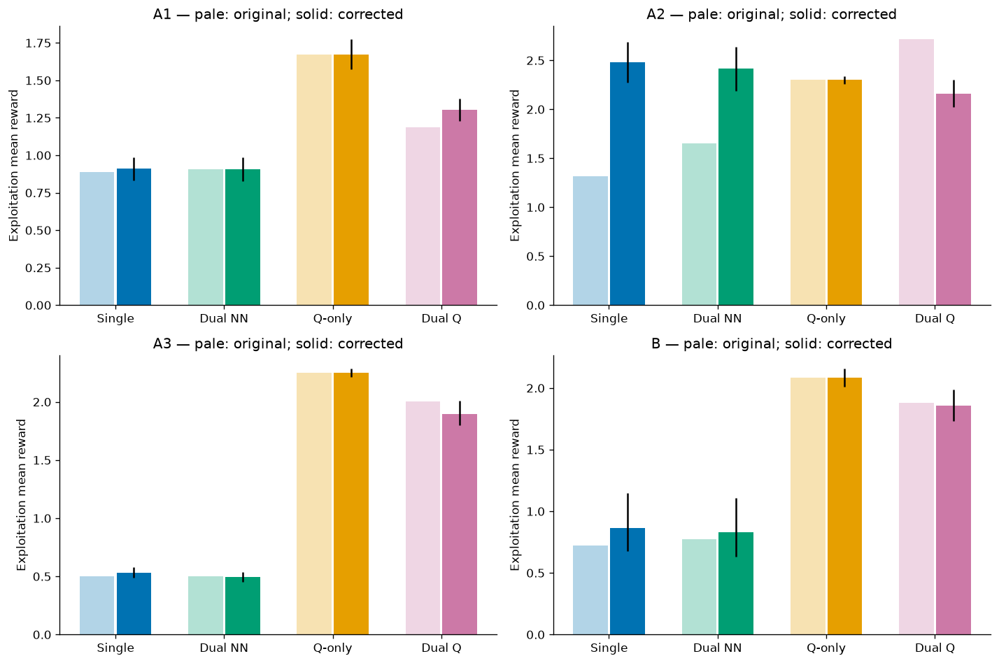
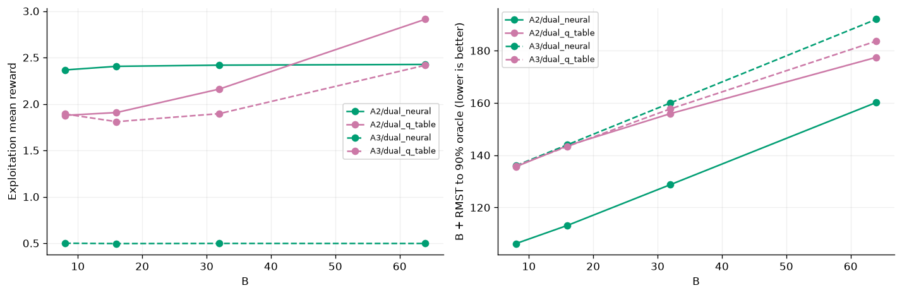

# Corrected full-study 결과 해석

분석 대상: commit `9a81b2d`에 업로드된 `examples/full_study_corrected_v1` 및 `examples/full_study_corrected_speed_v1`. 원본 full-study 및 CPU pilot과 구분한다. 본 분석은 집계 JSON 및 survival summary를 읽었으며 새 학습/평가를 실행하지 않았다.

## 핵심 결론

1. **Type 2에서는 Neural 성능이 크게 개선됐지만, Type 3와 mixed에서는 history 활용 문제가 남아 있다.**
2. **Dual Neural이 Single보다 빠르게 적응한다는 일관된 근거는 없다.** Main B=32의 paired normalized AUC/RMST 차이는 네 regime 모두 0을 포함한다. A2의 90% reach에서 +1%p의 작은 exploratory 차이는 있으나 전반적인 속도 우위를 뜻하지 않는다.
3. **Type 2 개선을 hidden reward inference의 성공으로 바로 해석하면 안 된다.** Optimal-combo usage가 약 1/3이고 B를 늘려도 Neural 성능 변화가 작아, same-action 반복 같은 일반적인 행동 규칙을 학습한 가능성이 있다. 이는 가설이며 실제 행동과 history intervention 확인이 필요하다.
4. **Type 3는 exploration과 exploitation 양쪽을 점검해야 한다.** Learned explorer의 discovery가 81%→60%로 떨어졌고, 발견한 combo의 Neural 재사용률은 약 9.3%다.
5. **긴 history를 쓰는 Dual Q에는 긍정적인 신호가 있다.** A2/B64에서는 Q-only보다 높은 threshold 도달과 normalized AUC가 개선된다. 그러나 learned prefix가 random/repeat/coverage보다 우수하다는 비교는 없고, 탐색 비용까지 포함한 총 reward 우위도 별개다.

## 1. 데이터 범위와 검증

- Reward/기타 aggregate: 3,712행.
- Speed aggregate: 10,240행.
- Paired speed contrast: 2,880행.
- 각 regime의 all-type 집계는 5 seeds, 500 world evaluations로 표시되어 있다.
- Q-only의 수정 전후 mean/std/worst/표본 수 888개 summary 비교가 모두 동일했다.
- Survival curve의 단조성, `survival + reach = 1`, 마지막 reach와 Reach@K, survival 적분과 RMST의 일치 2,560건을 검증했다.
- Dual pair의 discovery summary 56건이 동일했다. 이것은 prefix 요약 일치 검증이며 원시 trajectory 동일성 검증을 대신하지 않는다.
- Normalized AUC sum = 113 × normalized AUC mean을 확인했다. K=128, full window=16이므로 첫 15 steps는 AUC에서 제외된다.
- A1 absolute ratio는 499 worlds가 유효하며 1개가 undefined다. A1 baseline-normalized 및 나머지 all-type B32 기준은 500 worlds다.

**현재 업로드에 없는 자료:** corrected run의 config, costs, provenance, completion/failure markers, per-world metrics, raw JSONL, checkpoints, training/runtime/GPU logs. 따라서 실제 완료 job 수, 실행 config, optimizer/gradient 이력, seed별 raw 성능, 수정 전후 paired CI는 새로 검증할 수 없다. 현재의 CI는 업로드된 값을 사용한다. Q-only 일치는 통제 조건이 유지되었다는 강한 정합성 근거지만 모든 world identity의 직접 검증은 아니다.

재현: repository root에서 `PYTHONPATH=. python analysis/corrected_full_study/analyze.py` 실행. Matplotlib/Numpy가 필요하다. [검증 결과](audit.json)

## 2. Main reward: online, B=32, K=128

값은 K 구간 step당 평균 reward이며 `기존 → corrected`다.

| Regime | Single | Dual Neural | Q-only | Dual Q |
|---|---:|---:|---:|---:|
| A1 / Type 1 | 0.889 → 0.910 | 0.908 → 0.909 | 1.672 → 1.672 | 1.188 → 1.303 |
| A2 / Type 2 | 1.317 → 2.482 | 1.651 → 2.418 | 2.299 → 2.299 | 2.715 → 2.161 |
| A3 / Type 3 | 0.499 → 0.534 | 0.502 → 0.498 | 2.248 → 2.248 | 2.005 → 1.896 |
| Mixed | 0.722 → 0.863 | 0.771 → 0.829 | 2.082 → 2.082 | 1.878 → 1.860 |

A2의 변화는 크다. Single의 corrected CI는 [2.276, 2.687], Dual Neural은 [2.185, 2.639]다. 다만 이 값으로 정확한 수정 전후 paired 검정을 수행한 것은 아니다. A2에서 Neural이 Q-only보다 높은 point estimate를 가지지만, 그 차이의 paired 유의성도 원시 기록 없이 새로 계산하지 않았다.

업로드 코드의 corrected config를 사용했다면 main update는 policy당 4,800→600, pretraining update는 1,200→152로 바뀐다. 이는 **config로 계산한 예상치**이며 실제 costs 로그를 확인한 값은 아니다. Batch size, normalization, boundary target, pretraining 결과가 함께 달라졌으므로 개선을 normalization 하나의 인과 효과로 단정할 수 없다.

## 3. Frozen vs online: A2 개선은 gradient adaptation 때문만은 아니다

| A2 | Frozen | Online |
|---|---:|---:|
| Single | 2.506 | 2.482 |
| Dual Neural | 2.417 | 2.418 |

수정된 A2 성능은 frozen 상태에서도 높다. Online PPO가 추가로 크게 향상시키지는 않는다. 이는 학습된 행동 규칙 또는 recurrent adaptation의 변화와 일치하지만, 두 설명을 구분하지 못한다. Frozen이라는 이유만으로 history-based inference 성공을 뜻하지는 않는다.

## 4. Type 2: discovery가 늘어도 활용은 plateau

Dual exploration의 좋은 combo discovery는 36.2%→77.2%로 증가했다.

| A2 / online | 기존 | Corrected |
|---|---:|---:|
| Dual Neural: 발견 world에서 해당 combo 활용 | 7.0% | 40.1% |
| Dual Neural: 전체 world optimal-combo 사용 | 24.8% | 33.4% |
| Dual Q: 발견 world에서 해당 combo 활용 | 71.1% | 38.2% |
| Dual Q: 전체 world optimal-combo 사용 | 29.2% | 29.5% |

여기서는 원본/수정 집계 파일의 동일한 equal-seed 통계를 사용했다. 이전 분석 문서의 pooled-found-world conditional 통계와 소수점 수준에서 다를 수 있다. 또한 발견한 world 집합 자체가 바뀌므로 conditional 활용률의 수정 전후 비교에는 selection 효과가 있다.

Dual Neural의 B 변화:

| B | Discovery | Exploitation reward | Optimal-combo 사용 | 90% reach |
|---:|---:|---:|---:|---:|
| 8 | 40.2% | 2.366 | 32.4% | 32.4% |
| 16 | 58.8% | 2.405 | 33.2% | 32.6% |
| 32 | 77.2% | 2.418 | 33.4% | 32.8% |
| 64 | 87.4% | 2.426 | 33.7% | 32.8% |

History가 더 많은 좋은 combo를 포함해도 최적 사용률이 약 1/3에서 정체된다. 세 same-action 후보 중 하나를 반복하는 일반 규칙으로도 일부 world에서 높은 성능이 나올 수 있으므로, **같은 action 반복 baseline 및 real/shuffled/reset history 비교**가 우선이다. 실제 정책이 무조건 반복한다고 확정한 것은 아니다.

탐색 비용도 중요하다. A2/B32의 B 구간 평균 reward는 Single 2.205, Dual explorer 0.606이다. K 평균은 2.482 vs 2.418이고, 총 B+K return은 388.22 vs 328.86이다. 현재 point estimates에서는 분리된 탐색의 비용을 더 높은 K 성능으로 회수하지 못했다. 총 return과 lambda=.1로 B를 가중한 training objective는 서로 다른 지표다.

Dual Q의 reward 하락은 Q-only가 그대로인 점과 함께 봐야 한다. Same Q update라면 변경된 prefix의 방문 분포, 반복 관측 수, replay 효과가 주요 후보다. 발견률이 높다고 같은 Q exploiter에 더 유용한 history라는 뜻은 아니다. 현재 raw history가 없어 원인은 미확정이다.

## 5. Type 3: 정보 활용의 실패가 계속된다

B32의 Single/Dual Neural은 각각 0.534/0.498이다. Baseline-normalized adaptation AUC mean은 다음과 같다.

| Method | Random 대비 normalized progress | 95% CI |
|---|---:|---:|
| Single | 0.0136 | [0.0056, 0.0220] |
| Dual Neural | 0.0050 | [−0.0042, 0.0133] |
| Q-only | 0.3559 | [0.3473, 0.3637] |
| Dual Q | 0.2839 | [0.2635, 0.3063] |

이는 full trailing-window curve를 world별로 정규화한 후 평균한 값이다. Raw reward 평균의 비율과 같지 않다.

- Learned prefix discovery: 기존 81.0% → corrected 60.0%.
- Corrected Single prefix discovery: 83.0%.
- 동일 learned history에서 발견 combo 재사용: Neural 9.3%, Q 31.4%.
- Neural의 전체 optimal-combo 사용: 약 9.5%. B=8~64에서도 거의 동일.
- Neural 두 방법 모두 B32에서 75%/90% threshold 미도달. RMST@90%=128은 모든 episode가 censoring되었다는 의미다.

따라서 현재 Type 3에서는 더 많은 GPU 시간이나 B만 늘리는 것이 우선 해결책이라는 근거가 약하다. Explorer의 history 품질과 exploiter의 표현/optimization을 분리해 확인해야 한다. GRU가 근본적으로 불가능한 architecture라는 결론은 아니다.

## 6. Adaptation speed: 평균 reward와 다른 정보를 준다

Main B32, absolute ratio, online. W=16, hold=8, 시간은 유지 조건을 확인한 exploitation step이다. 미도달은 K=128에서 censoring한다.

| Regime | Method | Reach@50% | Reach@90% | RMST@90% |
|---|---|---:|---:|---:|
| A2 | Single | 47.8% | 31.8% | 97.25 |
| A2 | Dual Neural | 47.2% | 32.8% | 96.75 |
| A2 | Q-only | 55.6% | 0.4% | 127.78 |
| A2 | Dual Q | 48.8% | 8.2% | 123.91 |
| A3 | Single | 0.8% | 0% | 128.00 |
| A3 | Dual Neural | 1.6% | 0% | 128.00 |
| A3 | Q-only | 50.4% | 0% | 128.00 |
| A3 | Dual Q | 36.8% | 5.2% | 125.72 |

Q-only는 중간 수준의 reward에 안정적으로 도달하지만 높은 combo 전략에 도달하는 경우는 드물다. Dual Q는 평균 성능이 낮더라도 일부 world에서 높은 threshold를 달성한다. Threshold 하나만 보면 이 tradeoff를 놓친다.

Dual Neural − Single의 main paired AUC 차이:

| Regime | Normalized AUC sum 차이 | 95% CI |
|---|---:|---:|
| A1 | −2.032 | [−12.770, +2.996] |
| A2 | −0.738 | [−2.665, +1.351] |
| A3 | −0.880 | [−2.112, +0.348] |
| Mixed | −1.366 | [−4.433, +1.736] |

모두 0을 포함한다. 동등성을 증명한 것은 아니다. A2 reach@90%는 Dual이 +1%p이고 CI [+0.2, +2.2]%p지만, 다중 비교 보정 없는 작은 차이이며 RMST/AUC의 일관된 우위와 구분한다.

[추출한 main speed](main_speed.json), [업로드된 paired contrasts의 main subset](paired_main.json)

## 7. 긴 B: Dual Q의 긍정적 결과와 비용

A2/B64에서:

- Dual Q reward 2.912 vs Q-only 2.447.
- Reach@90%: 24.0% vs 0.8%.
- RMST@90% 차이: −14.186 steps, paired CI [−17.139, −11.474].
- Normalized AUC sum 차이: +9.480, paired CI [+6.682, +12.225].
- 총 B+K return: Dual Q 410.46 vs Q-only 412.49. Exploitation 우위가 총 return 우위와 같지는 않다.

이는 같은 B64 budget에서 prefix+Q 접근이 높은 수준의 적응에 유리할 수 있다는 긍정적인 증거다. 하지만 learned prefix가 random/repeat/coverage보다 좋은지는 별도 control이 필요하다.

한 방법 안에서 B8→B64로 늘리는 경우에도 전체 비용을 보아야 한다. A2 Dual Q의 RMST@90%는 127.60→113.44로 감소하지만, B를 더한 비용은 135.60→177.44로 증가한다. A3 Dual Q도 127.89→119.65이지만 B 포함 시 135.89→183.65다. B 간 paired CI는 현재 업로드에 없어 point estimate 비교로 한정한다.

A3/B64 Dual Q는 reward 2.417로 Q-only 2.393과 비슷하지만 총 return은 326.15 vs 403.12다. 고보상 combo를 찾는 일부 성공과 전체 탐색 비용의 손실이 공존한다.

## 8. Mixed generalization

Mixed에서 Type 2 neural 성능이 크게 낮아진다.

| Type 2 | Specialized A2 | Mixed의 Type 2 |
|---|---:|---:|
| Single | 2.482 | 1.137 |
| Dual Neural | 2.418 | 1.061 |

다만 specialized는 500 worlds, mixed의 type2는 165 worlds이고, 현재 집계만으로 동일 world에 맞춘 paired 비교를 새로 할 수 없다. 또한 같은 총 episodes에서 mixed는 type당 exposure가 줄어든다. 이 결과만으로 representation interference가 원인이라고 단정하지 않는다.

Mixed neural의 baseline-normalized AUC mean은 Single .0535, Dual .0359이고 두 CI 모두 0을 포함한다. Mixed의 높은 raw reward 일부만으로 일반화 성공을 선언하기 어렵다.

## 9. 다음 실험의 우선순위

1. **현재 GPU run의 training.jsonl/config/costs/provenance 확보:** actor/critic gradient ratio, entropy, KL, clipping, critic error, 실제 update 수 및 seed별 학습 curve를 확인한다. CPU pilot에서 관찰한 critic dominance가 GPU full-study에서도 있었다고 가정하지 않는다.
2. **Type 2의 구조적 반복과 history inference 분리:** full-policy repeat baseline, 동일 post-B state의 real/reward-shuffled/reset history, B 동안 rewarding combo 관측 여부에 따른 suffix 행동을 비교한다.
3. **Type 3의 exploiter 단독 진단:** 동일 observed coverage history를 Neural/Q에 공급하고, 관측 기반 reward mean/count probe 및 GRU+TD 대조로 memory와 update algorithm을 분리한다. Hidden combo 정답을 policy에 입력하지 않는다.
4. **Explorer의 유용성 검증:** 고정한 exploiter에 learned/random/repeat/coverage/Q-history를 넣어 reward와 threshold/RMST를 paired 비교한다. Discovery 증가만을 성공으로 정의하지 않는다.
5. **Mixed exposure 통제:** 같은 총 interaction 비교와 type별 exposure를 맞춘 비교를 따로 수행한다.

현재 근거로는 더 큰 GRU나 Transformer 교체보다 위 진단이 먼저다. 학습 코드는 이번 분석에서 변경하지 않았으며 추가 full-study도 실행하지 않았다.
