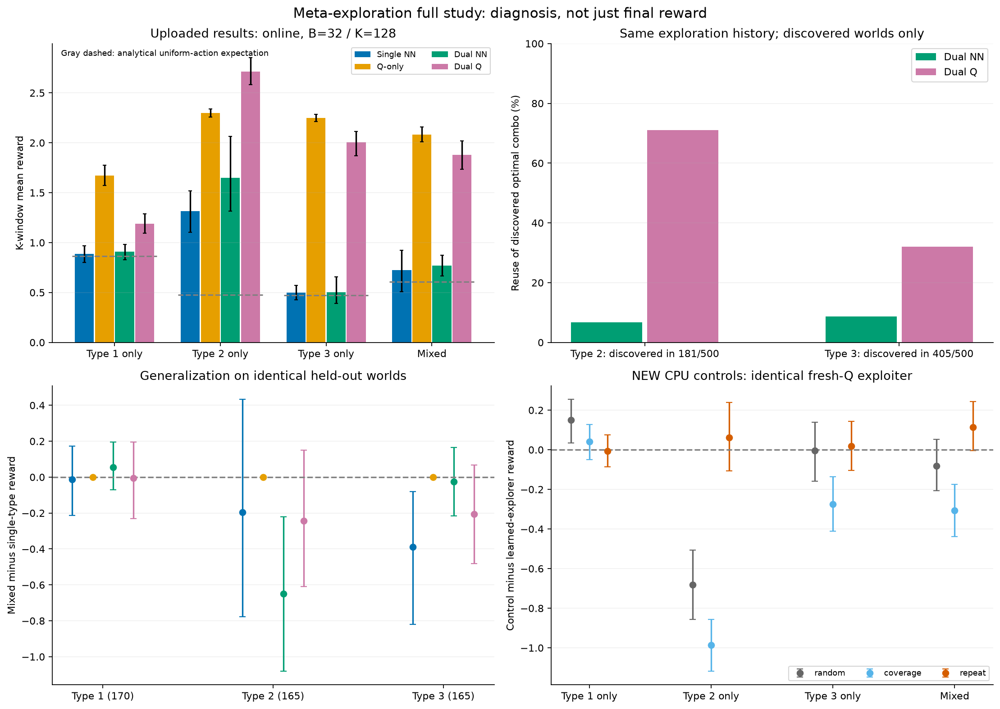
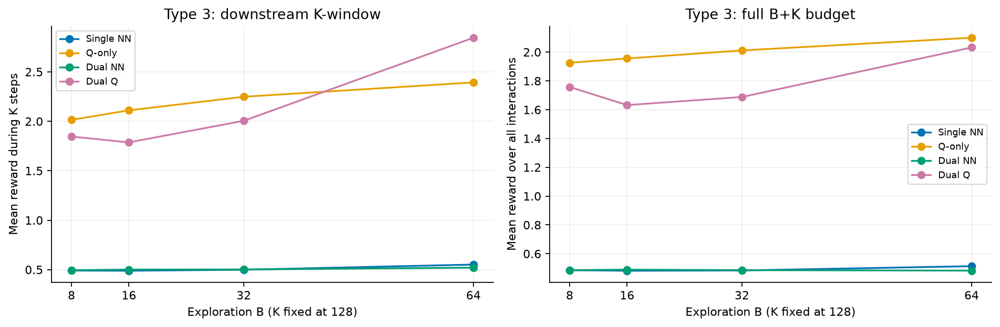

# Full-study 결과 분석

분석 대상: GitHub commit `6495e0a`의 `examples/full_study/`. 소스 코드는 직전
`292a52a`와 동일하며, 업로드 commit은 결과만 추가했습니다. 실제 실행 commit의
별도 provenance 파일은 없습니다. 아래는 **업로드된 실험 결과**와 **이번 분석에서
추가로 실행한 CPU 대조 실험**을 구분합니다. 기존 학습 코드와 결과는 수정하지 않았습니다.

## 핵심 판단

**파이프라인 실행은 완료됐지만, 현재 결과로 learned meta-exploration 또는
Dual Neural의 우월성을 주장하기는 어렵습니다.** 가장 명확한 결과는 같은 history를
받아도 Q exploiter가 Neural exploiter보다 높은 성능을 낸다는 점입니다.
Type 2에서 Dual Q의 성능은 좋지만, 추가 대조 실험에서는 학습 없이 단일 action을
반복하는 prefix로도 비슷한 성능이 나왔습니다. 또한 코드 audit에서 **episode 내부
advantage normalization이 downstream 성능 신호를 제거할 수 있는 문제**를 재현했습니다.
따라서 현재 neural 성능을 연구 가설 자체의 실패로 해석하면 안 됩니다.



## 1. 실행 및 데이터 검증

- A1/A2/A3/Mixed × 5 seeds = 20개 job에 완료 marker가 있습니다.
- 설정은 모두 동일: train worlds 60, pretraining 300 episodes, main training
  1,200 episodes, hidden 64, training B=32/K=128, neural gamma=1, GAE lambda=.95,
  exploration reward lambda=.1, Q gamma=.99.
- Test는 seed/regime당 100 worlds, B∈{8,16,32,64}, K=128, frozen/online 두 조건입니다.
- Raw metric **64,000행**, aggregate **3,712행**을 검증했습니다. 중복 key가 없고,
  aggregate의 seed별 평균 가중 방식으로 raw 결과와 수치가 일치합니다.
- Dual Neural/Q의 prefix combo counts·발견 지표·prefix 내 AUC를 **16,000개 조건**에서
  대조했습니다. 일치합니다. 이것은 prefix 요약 일치 검증이며, 미업로드된 step별
  trajectory 전체가 byte-for-byte 같다는 검증을 대신하지는 않습니다.
- Q 방법들의 frozen/online 값도 16,000개 조건에서 일치합니다. Frozen은 neural
  weights만 고정하는 조건이므로 의도한 동작입니다.
- 중복을 제거한 test worlds 1,500개를 seed/config로 재생성했고, 업로드된 exact
  oracle 값과 일치하는 것을 확인했습니다. 아래 새 Q 대조 실험에서는 기존 Q-only
  결과도 1,500개 world에서 정확히 재현했습니다.
- `training.jsonl`, raw history JSONL, checkpoints, runtime/GPU utilization logs는
  업로드되지 않았습니다. Initial weight equality, 실제 gradient 크기, loss 분해,
  parameter drift, GPU 처리량은 이번 업로드만으로 재검증할 수 없습니다.

## 2. 주 결과: Online, B=32 / K=128

각 값은 **K 구간 step당 평균 reward**입니다. 각 regime에 5 seeds × 100 worlds.
합계 exploitation return을 원하면 128을 곱하면 됩니다.

| Regime | Single Neural | Q-only | Dual Neural | Dual Q |
|---|---:|---:|---:|---:|
| A1: Type 1 only | 0.889 | **1.672** | 0.908 | 1.188 |
| A2: Type 2 only | 1.317 | 2.299 | 1.651 | **2.715** |
| A3: Type 3 only | 0.499 | **2.248** | 0.502 | 2.005 |
| B: Mixed aggregate | 0.723 | **2.082** | 0.771 | 1.878 |

Dual Neural − Single의 paired mean 차이와 95% interval:

| Regime | 차이 | 95% paired hierarchical bootstrap CI |
|---|---:|---:|
| A1 | +0.019 | [-0.043, +0.098] |
| A2 | +0.334 | [-0.102, +0.782] |
| A3 | +0.003 | [-0.104, +0.116] |
| Mixed | +0.049 | [-0.127, +0.266] |

**네 조건 모두 interval이 0을 포함합니다.** A2의 평균 차이는 긍정적이지만 seed별
차이가 +1.043에서 -0.371까지 변합니다. 이 설정에서 neural policy 분리의 일관된
우월성은 확인되지 않았습니다. 이는 두 방법이 동등하다는 equivalence 검정도 아닙니다.

같은 learned history를 받는 Dual Q − Dual Neural 차이는 A1 +0.280, A2 +1.064,
A3 +1.503, Mixed +1.107이고, 각 interval은 모두 0보다 높습니다. **현재 구현과
학습량에서는 Q exploiter가 우세**합니다. Q/Neural의 discount, optimizer, 사전학습
비용이 다르므로 이를 모든 neural/tabular 방법에 대한 일반론으로 확장하면 안 됩니다.

## 3. Neural은 무엇을 학습했는가?

재생성한 world에서 uniform-random action policy의 정확한 기대 K reward를 계산했습니다.
이는 **새 neural 실험 수치가 아니라 analytical reference**이며, hidden parameters는
reference 계산에만 사용했습니다.

| Regime | Uniform action 기대값 | Single online | Dual Neural online |
|---|---:|---:|---:|
| A1 | 0.863 | 0.889 | 0.908 |
| A2 | 0.477 | 1.317 | 1.651 |
| A3 | 0.470 | 0.499 | 0.502 |
| Mixed | 0.607 | 0.723 | 0.771 |

A1/A3의 neural 평균은 uniform reference에 가깝습니다. A2에는 확실히 다른 행동
구조가 있지만, 아래의 action bias와 발견/활용 불일치가 큽니다. 모든 neural 모델이
완전히 학습하지 않았다고 단정할 수는 없으나, **history에 따라 좋은 행동을 선택하는
능력이 충분히 형성됐다고 보기 어렵습니다.**

Frozen → Online의 개선은 있습니다. Dual Neural 기준 A1 +0.028, A2 +0.154,
A3 +0.093, Mixed +0.098입니다. Online adaptation이 작동하지 않는 것은 아니지만,
이 개선이 Q 방법과의 차이를 메우지는 못했습니다.

A3의 reward를 실제 기록의 AUC/total return으로 구간별 재계산하면:

| Method | steps 1–32 | 33–64 | 65–128 | 129–160 |
|---|---:|---:|---:|---:|
| Single | 0.420 | 0.453 | 0.497 | 0.551 |
| Q-only | 1.065 | 1.960 | 2.274 | 2.484 |
| Dual Neural | 0.420 | 0.364 | 0.506 | 0.633 |
| Dual Q | 0.420 | 1.682 | 2.020 | 2.299 |

Q의 빠른 적응과 neural의 작은 개선이 구분됩니다. Raw per-step JSONL이 없으므로
새 그림에서 이 구간 평균을 세밀한 step trajectory인 것처럼 보간하지 않았습니다.

## 4. Exploration과 information utilization을 분리하면

아래 utilization은 **B에서 실제 good combo를 시도한 world들만 대상으로 한 pooled
평균**입니다. 업로드 aggregate의 equal-seed conditional 평균과 미세하게 다를 수 있습니다.
발견은 hidden-diagnostic 기준 실제 시도이며, agent가 확신했다는 의미가 아닙니다.

| 조건 | B에서 good combo 시도 | 반복 관측으로 evidence 확보 | 발견한 combo의 Neural 재사용 | 같은 history의 Q 재사용 |
|---|---:|---:|---:|---:|
| A2 learned explorer | 36.2% (181/500) | 34.8% | **6.7%** | **71.1%** |
| A3 learned explorer | 81.0% (405/500) | 51.6% | **8.7%** | **32.1%** |

A3에서는 81%의 world에서 이미 좋은 combo가 history에 있습니다. 따라서 neural의
낮은 성능을 탐색 실패만으로 설명할 수 없습니다. 같은 H를 받은 Q가 그 combo를
훨씬 자주 활용하는 것도 이를 뒷받침합니다. 다만 causal history-use를 확정하려면
real/shuffled/empty-history ablation이 필요합니다.

A2 explorer의 sequence 다양성은 매우 낮습니다. B의 16개 valid pair 시도에서 평균
고유 pair 수가 1.996개이고, same-action 비율은 91.7%입니다. 각 seed의 dominant
pair가 전체 시도의 84.6%, 95.5%, 87.9%, 96.9%, 92.3%를 차지합니다.

예를 들어 seed 1은 탐색의 95.5%를 BB에 사용합니다. 그런데 BB가 실제 좋은 combo인
world에서 neural exploiter의 optimal-combo utilization은 0.16%이고, CC가 좋은
world에서는 65.3%입니다. **Seed별 action bias와 두 policy의 불일치에 부합하는
패턴**입니다. Checkpoint와 history ablation 없이 내부 표현의 원인을 단정하지는 않습니다.

참고로 이 medium setup의 primary combo는 9개 ordered pair 중 하나입니다. Uniform
random prefix에서 16번의 독립 pair 시도로 그 combo를 한 번 이상 시도할 확률은
`1-(8/9)^16 = 84.8%`입니다. A3의 81% 발견률만으로 고급 meta-exploration이 학습됐다는
근거가 되지는 않습니다.

## 5. 이번 분석에서 추가 실행한 대조 실험

**아래 값들은 업로드된 main experiment가 아닙니다. 이번 분석에서 CPU로 실제 실행한
exploratory controls입니다.** B=32/K=128, 동일한 held-out worlds·noise/opponent seeds를
사용했습니다. 각 prefix 뒤에는 기존 Dual-Q와 동일한 fresh Q-table, replay 10회,
Q gamma/alpha/epsilon, exploitation action seed를 사용했습니다.

- Random: 매번 uniform random action.
- Coverage: 모든 9개 ordered pair를 순회하는 기존 observed-only collector.
- Repeat: 무작위 action 하나를 선택해 B 동안 반복. World type이나 정답을 보지 않음.
- Q history: Q-only가 online TD로 수집한 B history를 fresh Q에 전달. Prefix 동안의
  32번 Q update 비용은 추가로 존재함.

| Regime | Learned prefix + Q (원 결과) | Random prefix + Q | Coverage prefix + Q | Repeat prefix + Q | Q history + fresh replay |
|---|---:|---:|---:|---:|---:|
| A1 | 1.188 | 1.339 | 1.229 | 1.182 | 1.368 |
| A2 | 2.715 | 2.034 | 1.730 | **2.776** | 1.937 |
| A3 | 2.005 | **2.002** | 1.730 | 2.023 | 1.890 |
| Mixed | 1.878 | 1.797 | 1.572 | 1.992 | 1.738 |

- A2 Repeat − Learned = **+0.061**, CI **[-0.107,+0.238]**. Learned exploration이
  단순 반복 baseline을 이긴다는 증거가 없습니다. A2의 구조적 반복 prior는 유용하지만,
  그것이 neural meta-learning으로만 얻어지는 이점은 아닙니다.
- A3 Random − Learned = **-0.004**, CI **[-0.159,+0.139]**. 평균상 거의 같습니다.
- A1 Random − Learned = **+0.151**, CI **[+0.034,+0.254]**. 현재 learned prefix는
  이 Q exploiter에 대해 random보다도 불리했습니다.
- Q-history control의 결과는 replay를 추가하면 무조건 좋아진다는 해석도 반박합니다.
  Fresh-table 재구성, 데이터 분포와 replay dynamics를 함께 봐야 합니다.
- Coverage는 true pair를 많이 시도하지만 downstream reward가 낮습니다. Discovery
  coverage 하나가 좋은 history의 충분조건은 아닙니다. 희소한 Q state와 transition
  반복 관측, TD backup 안정성을 따로 진단할 가치가 있습니다.

새 control은 사전에 등록된 main 비교가 아니며 여러 탐색적 비교에 대한 multiplicity
correction을 적용하지 않았습니다. Interval은 exploratory evidence로 해석해야 합니다.
재현 스크립트와 per-world 결과를 같은 폴더에 저장했습니다.

## 6. Q-only도 optimal strategy를 풀어낸 것은 아님

A2/A3의 oracle K-step 평균은 각각 약 5.531/5.512입니다. 최고 main 방법도
A2 Dual Q 2.715, A3 Q-only 2.248이므로 oracle과 상당한 차이가 있습니다.

A3에서 Q-only의 optimal combo utilization은 8.3%, Dual Q는 26.5%입니다.
그런데 reward는 Q-only가 높습니다. Mean reward를 base와 combo bonus로 분해하면:

| A3 method | Base component | Combo bonus component | 합계 conditional-mean reward |
|---|---:|---:|---:|
| Q-only | 1.650 | 0.603 | 2.254 |
| Dual Q | 0.088 | 1.923 | 2.011 |
| Dual Neural | -0.110 | 0.618 | 0.508 |

Q-only는 즉시 reward가 좋은 행동에서 더 많이 벌고, Dual Q는 combo bonus를 더 많이
얻지만 그 외 행동의 base reward가 낮습니다. **최종 reward와 combo 활용을 따로 봐야
한다는 연구 목표가 실제 결과에서 중요하게 드러납니다.** 이 분해는 noise를 제외한
기록의 conditional mean에 기반하므로 앞 표의 sampled reward와 소폭 다릅니다.

## 7. Exploration budget: Type 3는 B=64에서 달라짐



A3에서 Dual Q의 K-window 평균은 B=8/16/32/64에 대해 1.846/1.787/2.005/2.845입니다.
B=64에서는 Q-only 2.393을 앞섭니다. Paired 차이 **+0.452**, CI **[+0.324,+0.580]**.

그러나 같은 B=64 조건의 전체 B+K return 차이는 **-12.95**, CI **[-30.19,+4.11]**이고,
AUC@128 차이는 **-46.24**, CI **[-56.76,-36.16]**입니다. 긴 exploration이 이후
exploitation을 개선했지만, early adaptation과 전체 budget의 비용을 회수했다는
근거는 없습니다. B가 증가하면 총 B+K도 증가하므로 서로 다른 B 간 비교에서도 이를
구분해야 합니다.

## 8. Mixed training과 generalization

Mixed test는 type당 33/34 worlds, single-type test는 100 worlds이므로 단순히 각
전체 평균을 빼지 않았습니다. **동일 seed와 world ID의 교집합**에서 비교했습니다.

- Type 2 Dual Neural: single-type **1.548 → mixed 0.900**.
  Mixed − single-type **-0.648**, CI **[-1.080,-0.221]**.
- Type 3 Single: **0.517 → 0.127**, 차이 **-0.389**, CI **[-0.820,-0.081]**.
- Type 3 Dual Neural: **0.498 → 0.473**, 차이는 작고 interval이 0을 포함.
- Q-only는 모든 공통 world에서 **정확히 동일**합니다. World 간 transfer가 없는
  baseline에 대해 기대되는 결과이자 비교 정렬의 sanity check입니다.

공통 Type 3 worlds에서 learned explorer의 same-action 비율은 specialized 36.5%에서
mixed 64.2%로 증가하고, discovery는 79.4%에서 45.5%로 감소합니다. Mixed의 반복
편향이 different-action 탐색을 방해하는 패턴입니다. 반대로 공통 Type 2에서는
혼합 학습이 반복 편향을 완화해 discovery가 40.0%에서 55.2%로 증가합니다.

총 training budget은 같지만 mixed에서는 각 type의 노출량이 약 1/3입니다.
따라서 현재 결과만으로 task interference와 type당 데이터 감소를 분리할 수는 없습니다.
고정 총예산에서의 mixed generalization 개선은 확인되지 않았다는 해석이 적절합니다.

## 9. 코드 audit에서 재현한 downstream-credit 문제

`meta_exploration/learning.py:155`는 다음 정규화를 수행합니다.

```python
adv = (adv - adv.mean()) / (adv.std(unbiased=False) + 1e-8)
```

문제는 식 자체보다 **정규화 범위**입니다. 현재 training은 한 episode씩 업데이트하며,
explorer에는 그 episode의 B-step advantage만 넘깁니다. 따라서 episode 간 downstream
성공/실패 차이를 유지하는 batch normalization이 아니라 **각 episode 내부 centering**입니다.

Gamma=1, GAE lambda=1이면 explorer return의 downstream 부분은 각 B-step에 동일하게
추가됩니다. `adv.mean()`을 빼면 그 공통 항이 정확히 사라집니다. 예를 들어 prefix
reward와 critic이 0일 때 K return이 128이든 1,280이든 정규화된 explorer advantage는
전부 0이 됩니다. Downstream 정책-gradient surrogate가 0이 되는 것이며,
entropy/value loss까지 없어지는 것은 아닙니다.

Main 설정인 GAE lambda=.95도 실제 `targets()`로 점검했습니다. Prefix reward와 critic을
0으로 두고 suffix reward를 1 대 10으로 바꾸면 raw explorer advantage 평균은
9.561 대 95.612지만, episode별 정규화 후 두 advantage vector의 최대 차이는
**7.15e-7**에 불과합니다. 두 episode를 하나의 batch로 묶어 정규화하면 episode별
평균은 -0.807 / +0.807로 구분됩니다.

이는 실제 world 성능을 새로 측정한 결과가 아니라 **생산 target 코드와 정규화 식을
사용한 재현 가능한 counterexample**입니다. 실제 학습에는 nonzero prefix rewards,
시간별 critic 값, noisy suffix rewards가 있으므로 모든 downstream credit이 항상
0이 된다고 주장할 수는 없습니다. 그러나 목표한 trajectory-level downstream learning
signal을 episode 간 보존하지 못할 수 있는 구조적 문제는 확인됐습니다.

이 부분은 제가 구현한 학습 경로에서 바로잡아야 합니다. 단순히 학습을 오래 돌리거나
GPU 수를 늘리는 것으로 해결할 문제가 아닙니다. **동일 policy version으로 여러
독립 episodes를 수집하고, policy별 전체 rollout batch에서 advantage를 정규화**하는
방식으로 수정한 뒤 regression test가 필요합니다. 기존 update/interaction 비용도
새 batch 구조에 맞춰 명시적으로 기록해야 합니다. Normalization-off 진단을 추가하는
경우에도 본 실험의 정규화 요구와 구분해야 합니다.

재현: `advantage_audit.py`, 결과: `advantage_audit.json`. 이 audit만으로 A1/A3의 neural
성능 저하 원인을 전부 확정할 수는 없으며, value loss/gradient 및 history-use 검증은
여전히 필요합니다.

## 10. 다음 실험의 우선순위

먼저 위 advantage normalization 범위를 수정하고, 높은 downstream return과 낮은
return을 가진 episode가 서로 다른 policy-gradient 신호를 유지하는 regression test를
추가해야 합니다. 그 다음 순서는 다음과 같습니다.

1. **Neural exploiter 단독 검증.** Shared-pretraining checkpoint와 final checkpoint에
   동일한 random/coverage/successful-observed history를 주고 frozen 성능을 비교합니다.
   먼저 쉬운 Type 1에서 uniform reference보다 의미 있게 나아지는지 확인해야 합니다.
2. **History intervention.** 동일 post-B environment snapshot에서 real history,
   shuffled rewards/actions, zero recurrent state를 비교합니다. 환경 상태를 바꾸지 않아야
   정보 활용 효과와 시작 상태 효과가 섞이지 않습니다.
3. **학습 진단 로그.** Actor/value loss, entropy, explained variance, actor/critic gradient
   norms, KL, update 전후 parameter change를 확인합니다. 현재 unnormalized long-horizon
   value target과 global gradient clipping, 한 world씩 업데이트하는 PPO의 높은 분산은
   점검할 후보지만, 업로드된 파일만으로 원인이라고 확정할 수 없습니다.
4. **단순 exploration controls를 정식 비교에 포함.** 특히 repeat와 random-prefix +
   동일 Q replay가 필요합니다. Learned가 이들을 넘는지 먼저 확인해야 합니다.
5. **Q replay/state ablation.** Type 1에서도 많은 history-dependent Q states를 쓰는
   비용, R1에서 불필요한 이전 action conditioning, replay passes/alpha, live Q 유지
   대 fresh Q 재구성을 비교합니다. Opponent dynamics에 필요한 관측은 보존해야 합니다.
6. 이후 충분히 학습된 neural backbone과 대조군을 확보한 상태에서 larger-K,
   equal-type-exposure mixed training, Q-aware explorer를 평가합니다.

GPU 수나 training steps를 단순히 늘리기보다, neural이 history를 읽고 있다는 증거와
쉬운 환경에서의 학습 성공을 먼저 확보하는 것이 현재 결과에 맞는 다음 단계입니다.

## 재현 및 파일

저장소 root에서 (설치된 프로젝트 환경 사용):

```bash
PYTHONPATH=. .venv/bin/python analysis/full_study/analyze.py
PYTHONPATH=. .venv/bin/python analysis/full_study/deep_checks.py
PYTHONPATH=. .venv/bin/python analysis/full_study/q_history_control.py
PYTHONPATH=. .venv/bin/python analysis/full_study/simple_history_controls.py
PYTHONPATH=. .venv/bin/python analysis/full_study/reward_decomposition.py
PYTHONPATH=. .venv/bin/python analysis/full_study/figures.py
PYTHONPATH=. .venv/bin/python analysis/full_study/advantage_audit.py
```

- `advantage_audit.json`: 실제 target 함수 기반 downstream-credit 정규화 counterexample.
- `analysis.json`: 검증, 원 결과 요약, paired contrasts, matched generalization.
- `deep_checks.json`: budget별 paired contrasts와 Type 2 seed별 편향.
- `q_history_control.json`, `simple_history_controls.json`: **추가 실행** 프로토콜,
  per-world 결과, paired intervals. 1,500개 unique worlds; mixed는 동일 world subset 재사용.
- `reward_decomposition.json`: base/bonus 분해.
- `mixed_exploration.json`: 공통 worlds의 탐색 편향.
- `overview.png/pdf`, `type3_budget_tradeoff.png/pdf`: 분석 그림.

Main mean/CI는 업로드 aggregate를 사용했고, 새 paired contrasts는 seed를 바깥 단위,
world를 안쪽 단위로 한 hierarchical bootstrap 5,000회입니다. Training seeds는 5개뿐이며,
500 worlds를 500개의 독립 training run처럼 해석하지 않았습니다.
